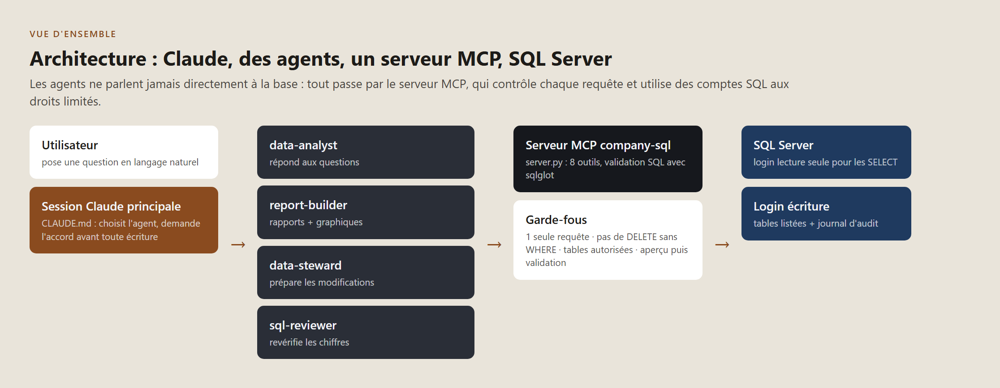
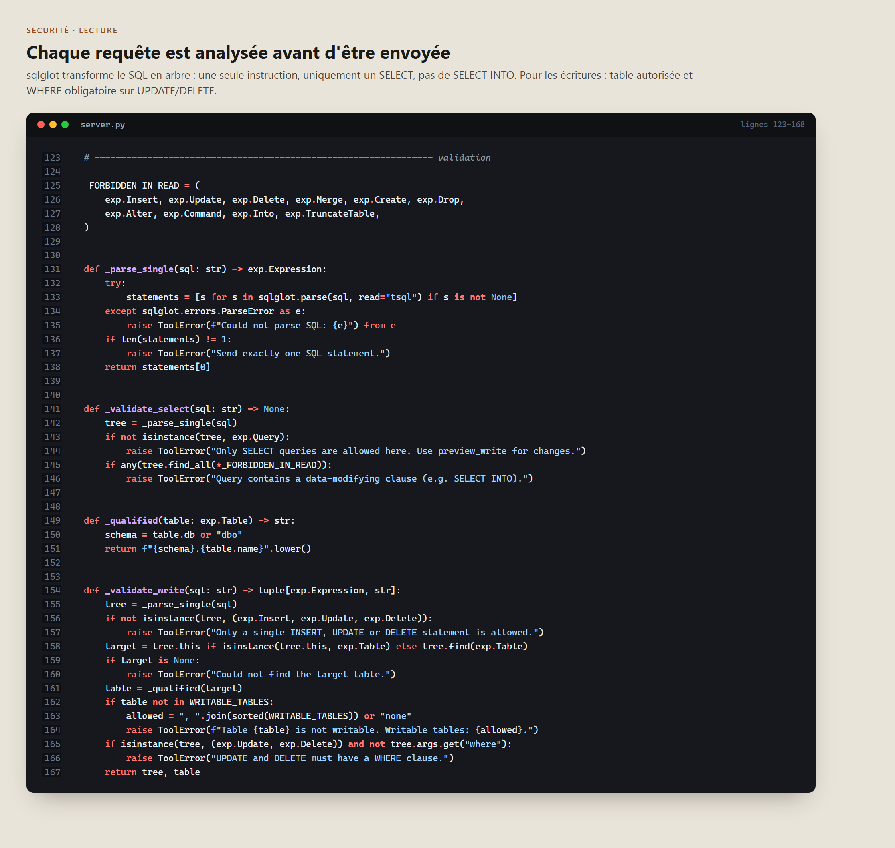
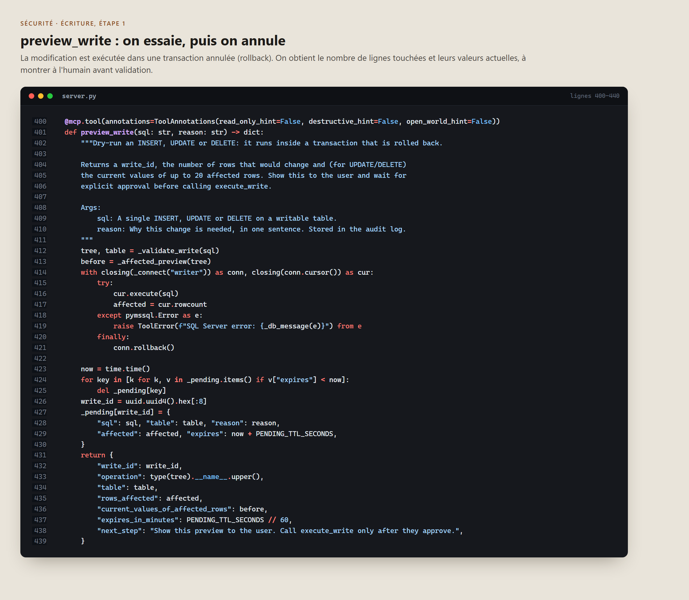
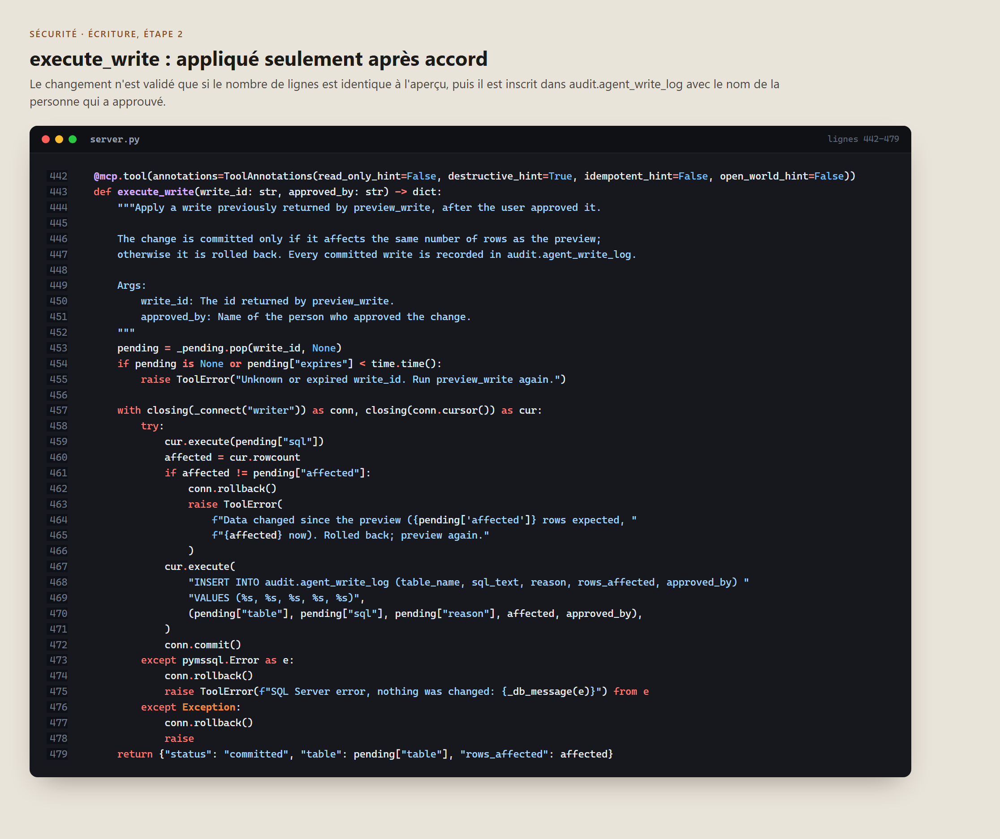
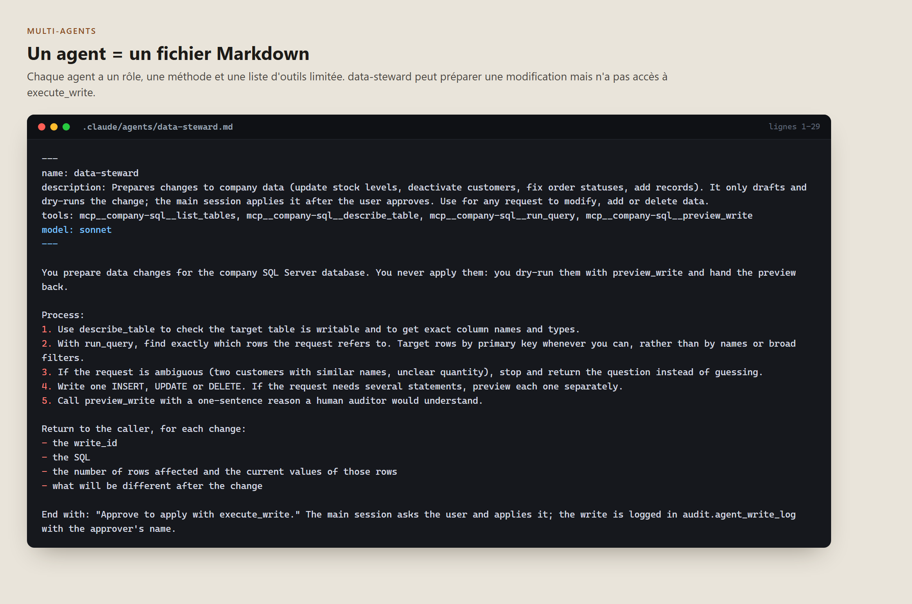
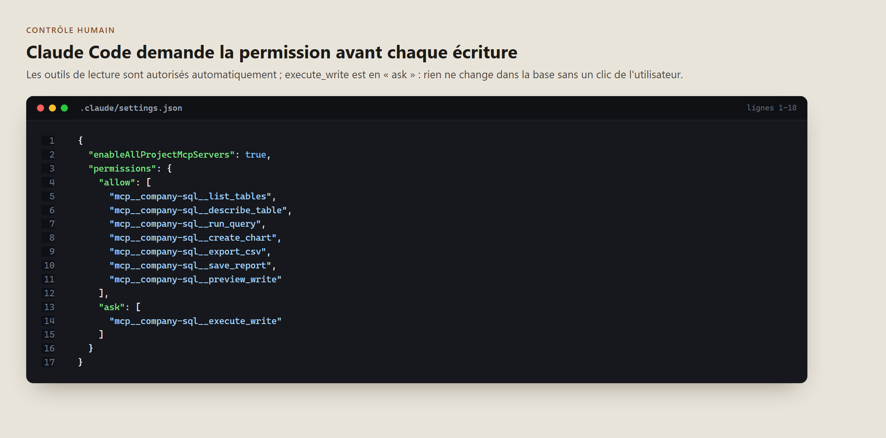
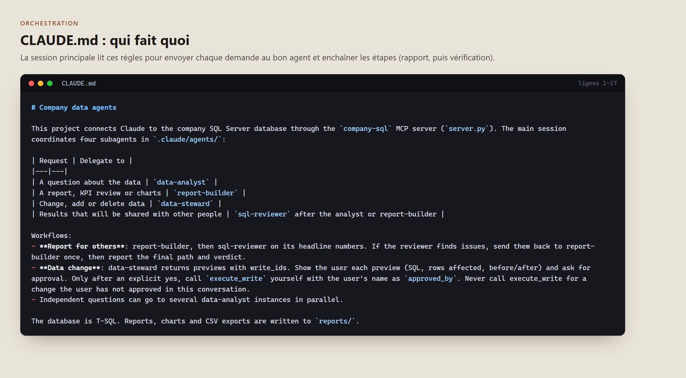
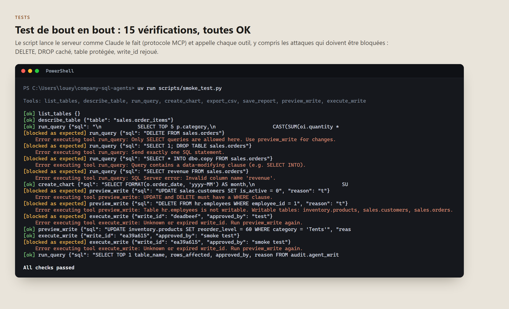
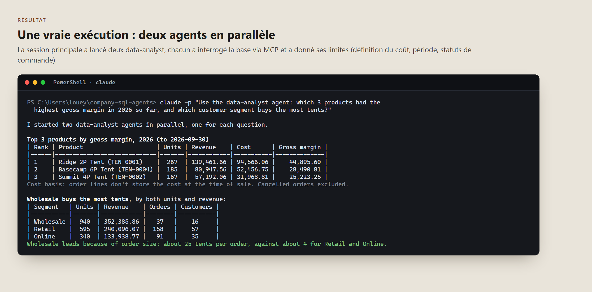
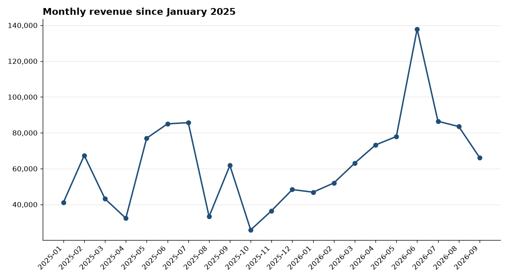

# Company SQL Agents : déroulement et choix

## 1. Le point de départ

L'idée : permettre à quelqu'un dans une entreprise de poser une question en français ou en anglais (« quels clients ont arrêté de commander ? ») et d'avoir la réponse tirée de la vraie base de données, sans écrire de SQL ni attendre l'équipe data.

Avant d'écrire une ligne de code, j'ai tranché quatre questions :

| Question | Mon choix | Pourquoi |
|---|---|---|
| Quelle base ? | **SQL Server** | C'est le moteur des ERP les plus courants dans les PME françaises (Sage, Cegid, Dynamics). C'est là qu'il y a des données et un besoin. |
| Comment Claude accède aux données ? | **Un serveur MCP sur mesure** | MCP est le standard ouvert pour brancher des outils sur Claude. Un serveur maison me permet de contrôler exactement ce que l'IA a le droit de faire. |
| Que doivent faire les agents ? | **Répondre, faire des rapports, modifier des données, travailler en équipe** | Les quatre usages réels en entreprise. Le plus délicat est l'écriture, et c'est lui qui a guidé l'architecture. |
| Sur quelles données tester ? | **Une base de démo dans Docker** | On ne branche pas une IA sur une base de production pour la première fois. Il me fallait un terrain d'essai réaliste. |

## 2. L'architecture

Le principe central : **les agents ne touchent jamais la base directement.** Tout passe par le serveur MCP, qui joue le rôle de guichet. Il vérifie chaque demande avant de la transmettre, et il se connecte avec des comptes SQL aux droits limités.

Pourquoi plusieurs agents plutôt qu'un seul ? Parce qu'en entreprise, ce sont des métiers différents :
- **data-analyst** répond aux questions ;
- **report-builder** produit des rapports avec graphiques ;
- **data-steward** prépare les modifications ;
- **sql-reviewer** revérifie les chiffres avant qu'ils partent chez quelqu'un.

Chacun n'a que les outils dont il a besoin. C'est le même principe que pour des employés : on ne donne pas les clés de tout à tout le monde.

## 3. La sécurité : la vraie difficulté

Laisser une IA écrire du SQL sur une base d'entreprise, c'est risqué. Une requête mal comprise peut effacer des données. J'ai donc empilé plusieurs protections indépendantes : si l'une rate, la suivante bloque.

**Couche 1 : les droits de la base.** Deux comptes SQL :
- `agent_reader` ne peut que lire. Même si tout le reste échoue, il est techniquement incapable de modifier quoi que ce soit.
- `agent_writer` ne peut modifier que les tables explicitement autorisées, et écrire dans le journal d'audit.

**Couche 2 : l'analyse de chaque requête.** Plutôt que de chercher des mots interdits dans le texte (facile à contourner), j'utilise **sqlglot**, qui transforme le SQL en arbre et permet de vérifier ce que la requête fait vraiment.

Ce qui est refusé :
- plusieurs instructions d'un coup (`SELECT 1; DROP TABLE ...`), la technique classique d'injection ;
- tout ce qui n'est pas un SELECT dans l'outil de lecture, y compris le piège `SELECT ... INTO` qui crée une table ;
- un UPDATE ou DELETE sans WHERE, qui modifierait toute la table ;
- toute écriture sur une table non autorisée.

## 4. L'écriture en deux temps

Pour les modifications, je me suis inspiré de ce qu'on fait en entreprise : **on montre avant d'appliquer.**

**Étape 1 : l'aperçu.** La modification est exécutée pour de vrai dans une transaction, puis annulée immédiatement. On obtient ainsi le nombre exact de lignes concernées et leurs valeurs actuelles, sans rien changer.

**Étape 2 : l'application.** Seulement après l'accord de l'utilisateur. Et une dernière vérification : si le nombre de lignes a changé entre l'aperçu et la validation (quelqu'un a modifié les données entre-temps), tout est annulé. Chaque modification validée est inscrite dans un journal d'audit avec le nom de la personne qui l'a approuvée.

Un détail important : l'agent `data-steward` **n'a pas accès** à l'outil qui applique les changements. Il prépare, la session principale demande l'accord à l'humain, puis applique.

Et en plus, Claude Code est configuré pour demander une permission explicite avant chaque écriture. Les lectures, elles, passent automatiquement pour que l'outil reste fluide.

## 5. L'orchestration

Un fichier `CLAUDE.md` sert de règlement intérieur : quelle demande va à quel agent, et comment enchaîner les étapes (par exemple : rapport, puis vérification par le reviewer, puis correction si besoin).

## 6. Les tests

Je n'ai pas voulu me contenter de « ça a l'air de marcher ». Le script de test lance le serveur **exactement comme Claude le fait** (protocole MCP) et appelle chaque outil, y compris avec des attaques qui doivent être bloquées.

Les tests m'ont fait trouver deux vrais problèmes, que j'ai corrigés :
1. **Les erreurs étaient muettes.** Quand une requête était refusée, Claude recevait juste « Error executing tool », sans savoir pourquoi. Il ne pouvait donc pas corriger sa requête. Maintenant il reçoit la raison précise (« Invalid column name 'revenue' ») et se corrige tout seul.
2. **La nouvelle version du SDK MCP** avait renommé ses classes. J'ai lu l'API installée plutôt que de coder de mémoire.

## 7. Le résultat en conditions réelles

Une vraie exécution : deux questions posées en même temps, la session principale lance deux agents analystes en parallèle, chacun interroge la base et donne sa réponse avec ses limites.

Ce que j'apprécie dans ce résultat : l'agent ne se contente pas du chiffre. Il explique **pourquoi** le segment Wholesale domine (des commandes de 25 tentes contre 4 pour les autres), et il signale ses propres limites (le coût est le coût actuel, pas celui au moment de la vente).

Et un graphique généré automatiquement par l'outil `create_chart` :

## 8. Ce que j'en retiens

- **La sécurité se pense en couches.** Les droits de la base sont la vraie protection ; le reste réduit les erreurs.
- **Une IA a besoin de bons messages d'erreur** pour se corriger, comme un humain.
- **L'humain reste dans la boucle** pour tout ce qui est irréversible.
- **Découper en agents spécialisés** rend chaque rôle plus simple à écrire, à tester et à limiter.

## 9. La suite

- Une interface web pour les utilisateurs non techniques (aujourd'hui il faut Claude Code) ;
- le branchement sur une vraie base d'entreprise, avec les comptes créés par le DBA (`scripts/create_logins.sql`) ;
- une spécialisation sur un ERP précis (Sage 100), où la vraie valeur est de connaître ses tables.
